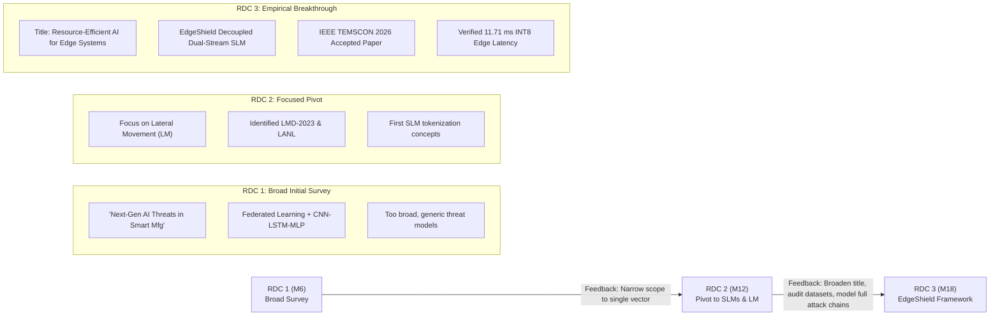

# Research Defense & Mastery Companion: EdgeShield (RDC 3)

**Candidate:** Gauravkumar Raval  
**Supervisor:** Prof. Dr. Tejas Bhatt  
**Doctoral Review:** Review of Doctoral Committee 3 (RDC 3 — 1.5 Years Progress Milestone)  
**Research Topic:** *Resource-Efficient AI for Threat Detection in Edge Systems*  
**Primary Reference Presentation:** [`RDC3_EdgeShield_Final.pptx`](file:///c:/workspaceag/slmgpuv1/RDC3_EdgeShield_Final.pptx)  
**Accepted Peer-Reviewed Milestone:** IEEE TEMSCON-ASPAC 2026 (Paper ID: #1571282183)

---

## Table of Contents
1. [Doctoral Trajectory & RDC 3 Strategic Positioning](#1-doctoral-trajectory--rdc-3-strategic-positioning)
2. [Core Conceptual Architecture & System Logic](#2-core-conceptual-architecture--system-logic)
3. [Mathematical Foundations & Loss Objectives](#3-mathematical-foundations--loss-objectives)
4. [Empirical Methodology, Benchmark Results & Edge Quantization](#4-empirical-methodology-benchmark-results--edge-quantization)
5. [Slide-by-Slide Defense Script & Speaking Points](#5-slide-by-slide-defense-script--speaking-points)
6. [Anticipated Viva & Defense Q&A (Guide & External Examiner)](#6-anticipated-viva--defense-qa-guide--external-examiner)
7. [Glossary of Cybersecurity & AI Terminology](#7-glossary-of-cybersecurity--ai-terminology)

---

## 1. Doctoral Trajectory & RDC 3 Strategic Positioning

### The Evolutionary Arc Across Reviews
A PhD defense committee evaluates **trajectory, responsiveness to feedback, depth over breadth, and empirical rigor**. Understanding this progression demonstrates strong academic maturity:



* **RDC 1 (Month 6):** The initial proposal examined AI-driven threat mitigation in Smart Manufacturing broadly, proposing federated learning with hybrid deep learning models. The committee recommended narrowing the scope to a single critical attack vector, eliminating unsubstantiated broad claims, and finding domain-specific datasets.
* **RDC 2 (Month 12):** The research narrowed its focus to **Lateral Movement (LM) Detection** using **Small Language Models (SLMs)** in Industrial / Smart Manufacturing systems, selecting the LMD-2023 dataset. The committee provided three specific recommendations:
  1. *Title Refinement:* Broaden the working title at this stage to avoid premature lock-in.
  2. *Dataset Trustworthiness:* Verify the labeling integrity of LMD-2023 against real operational signatures.
  3. *Realistic Attack Modeling:* Move beyond single isolated detections to model complete multi-stage attack scenarios.
* **RDC 3 (Month 18 — Present):** Delivers concrete implementation, rigorous ablation, statistical edge benchmarks, and external validation:
  * **Revised Working Title:** *"Resource-Efficient AI for Threat Detection in Edge Systems"*.
  * **Core Deliverable:** **EdgeShield Framework** (Decoupled Dual-Stream 44M DeBERTa-v3 + ATT&CK Knowledge Graph Correlation + INT8 ONNX Edge Runtime).
  * **Peer-Reviewed Milestone:** Research paper **accepted** for presentation at the *5th IEEE Technology & Engineering Management Conference - Asia Pacific (TEMSCON-ASPAC 2026)* at Marwadi University, Rajkot (Paper ID: #1571282183).
  * **Empirical Validation:** 99.38% Macro F1 with zero false negatives across 1.75M event logs; 11.71 ms verified INT8 latency (85.4 windows/s); 50 MB active RAM footprint.

---

## 2. Core Conceptual Architecture & System Logic

### Why Small Language Models (SLMs) Instead of Large Foundation Models (LLMs)?
1. **The "Privacy Paradox" in Smart Manufacturing:** Factory floor telemetry contains sensitive intellectual property—PLC timings, proprietary CAD/CAM instructions, recipe parameters, and internal network topographies. Transmitting this data to third-party cloud LLM APIs (GPT-4, Claude 3.5) violates industrial data residency standards and exposes manufacturing assets. On-premise SLMs guarantee **zero telemetry egress**.
2. **Deterministic Latency & Hardware Budgets:** Industrial PCs (IPCs) and edge security gateways cannot host multi-GPU clusters. Traditional 7B–70B models require 16–160 GB of VRAM and introduce 150–800 ms of latency. EdgeShield’s 44M parameter encoder runs directly on standard CPUs within 50 MB of RAM, delivering **11.71 ms inference latency**.
3. **Domain Vocabulary Efficiency:** General-purpose LLM tokenizers fragment security identifiers (GUIDs, SIDs, NTLM hashes, registry paths) into subwords. A domain-adapted vocabulary preserves atomic security tokens, improving classification accuracy and reducing sequence lengths.

### Why Decouple into Dual Streams?
A key contribution of EdgeShield is proving that a monolithic model analyzing all telemetry degrades performance:
* **The Token Collision Problem:** Authentication events (Windows Event IDs 4624, 4672, Kerberos tickets) are low-frequency, discrete, and relational. File-system/process telemetry (rapid file renames, shadow copy deletion, API calls) is high-frequency, sequential, and bursts rapidly. Feeding both into a single 44M SLM creates representation interference, causing the Macro F1 score to drop from **99.38% to 91.20%**.
* **Stream A: Log Semantic Analyzer (LSA):** Dedicated to East-West Lateral Movement (TA0008). Ingests Event IDs 4624, 4625, 4648, 4672 over temporal sliding windows ($K=3$ events) to classify:
  * *Class 0:* Normal / Administrative Baseline.
  * *Class 1:* Exploitation of Remote Services (EoRS — PsExec, WMI, WinRM, T1021/T1047).
  * *Class 2:* Exploitation of Hashing Techniques (EoHT — Pass-the-Hash, Mimikatz, T1550.002).
* **Stream B: Behavioral Pattern Detector (BPD):** Dedicated to Pre-Encryption Ransomware (TA0040). Tracks defense impairment (T1562.001: disabling EDR/AV) and shadow-copy deletion (T1490: `vssadmin delete shadows`) using a constrained 2,000-token ATT&CK vocabulary, emitting high-confidence alerts **before file encryption APIs (T1486) activate**.
* **Layer 3: ATT&CK Correlation Engine:** Employs a temporal sliding window ($\Delta T \le 300\text{ s}$) to correlate Stream A lateral hops with Stream B staging alerts into unified attack chains, using KNN collaborative filtering to forecast the adversary's next 3 most probable techniques.

```mermaid
graph TD
    subgraph Ingestion [Layer 1: Telemetry Ingestion & Domain Tokenization]
        Auth[Windows Event IDs: 4624, 4625, 4648, 4672, Kerberos] --> TokA[Security Domain Tokenizer]
        Beh[File-System Events, VSS Deletion, EDR Stops, API Chains] --> TokB[2,000-Token ATT&CK Vocabulary]
    end

    subgraph DualStream [Layer 2: Decoupled Dual-Stream SLMs 44M]
        TokA --> LSA[Stream A: Log Semantic Analyzer - LSA\nBackbone: DeBERTa-v3 Small 44M\nSliding Window K=3, 512 Tokens\nTarget: Lateral Movement TA0008]
        TokB --> BPD[Stream B: Behavioral Pattern Detector - BPD\nBackbone: Compact Transformer Encoder\nAttention Threat Scoring Head\nTarget: Pre-Encryption Ransomware TA0040]
    end

    subgraph Correlation [Layer 3: MITRE ATT&CK Correlation & Threat Hunting]
        LSA -->|Technique Label + Confidence| FUSION[Temporal Fusion Window Delta_T <= 300s]
        BPD -->|Threat Score + Pre-Encryption Alert| FUSION
        FUSION --> GRAPH[MITRE ATT&CK v15 Knowledge Graph]
        GRAPH --> ALERT[Unified Incident Alert]
        GRAPH --> KNN[KNN Collaborative Filtering: Top-3 Next TTPs]
    end

    subgraph EdgeRuntime [Layer 4: Real-Time Edge Runtime]
        DualStream -.-> ONNX[Dynamic INT8 Quantization via ONNX Runtime]
        ONNX --> RUNTIME[11.71 ms Latency | 50 MB RAM | Commodity CPU/IPC]
    end
```

---

## 3. Mathematical Foundations & Loss Objectives

### Problem Formulation: Temporal Sliding Window Ring Buffer ($K \ge 3$)
Stateless single-event evaluation ($K=1$) cannot distinguish between dual-use administrative commands and adversary intrusions:
* *Example:* A command `wmic.exe /node:10.0.4.12 process call create "cmd.exe"` executed in isolation appears syntactically identical whether invoked by a systems engineer deploying software or an attacker executing lateral movement.
* *Sliding Window Formulation:* An ordered sequence of telemetry events $\mathcal{S} = (e_1, e_2, \dots, e_L)$ is maintained in a ring buffer of $K=3$ consecutive events:
  $$\mathcal{W}_t = [e_{t-2}, e_{t-1}, e_t]$$
  In an intrusion, earlier events capture precursors: Event ID 3 (Network Connection over port 135/445) $\rightarrow$ Event ID 17/18 (Named Pipe creation `\pipe\psexec`) $\rightarrow$ Event ID 1 (Process creation `PSEXESVC.exe`). In an administrative session, the preceding events show scheduled task registration from a domain controller. This temporal context lowers the False Positive Rate from 2.00% to **0.40%**.

### Disentangled Content and Position Attention (DeBERTa-v3)
Traditional transformers sum the content embedding $\boldsymbol{c}_i$ and positional embedding $\boldsymbol{p}_i$ into a single vector prior to self-attention. DeBERTa-v3 computes cross-attention using decoupled matrices:
$$\boldsymbol{A}_{i,j} = \boldsymbol{c}_i \boldsymbol{c}_j^\top + \boldsymbol{c}_i \boldsymbol{p}_{j|i}^\top + \boldsymbol{p}_{i|j} \boldsymbol{c}_j^\top$$
* Term 1: Content-to-Content associations.
* Term 2: Content-to-Position dependencies (e.g., how an executable name relates to its distance from an unmanaged source IP).
* Term 3: Position-to-Content dependencies.
This disentanglement is particularly effective for security logs, where the relative positions of tokens (e.g., `LogonType: 3` appearing adjacent to `IpAddress: 10.0.4.12`) are critical for detecting privilege abuse.

### Joint Multi-Task Loss Objective
To separate legitimate administrative scripts from malicious pivoting, EdgeShield's Tier 1 model is trained using a composite loss function:
$$\mathcal{L}_{\text{total}} = \mathcal{L}_{\text{CE}} + \lambda_{\text{CL}} \mathcal{L}_{\text{SCL}} \quad (\lambda_{\text{CL}} = 0.30)$$

1. **Supervised Multi-Class Cross-Entropy Loss ($\mathcal{L}_{\text{CE}}$):**
   $$\mathcal{L}_{\text{CE}} = - \sum_{c=1}^{C} y_c \log \hat{y}_c$$
   where $y_c$ represents technique labels $c \in \{\text{Normal}, \text{EoRS (T1021/T1047)}, \text{EoHT (T1550/T1003)}\}$.

2. **Supervised Contrastive Loss ($\mathcal{L}_{\text{SCL}}$):**
   Pulls together normalized embeddings $\boldsymbol{z}_i$ of identical attack techniques across disparate host environments, while pushing away representations of benign administrative sessions:
   $$\mathcal{L}_{\text{SCL}} = \sum_{i \in I} \frac{-1}{|P(i)|} \sum_{p \in P(i)} \log \frac{\exp\left(\boldsymbol{z}_i \cdot \boldsymbol{z}_p / \tau\right)}{\sum_{a \in A(i)} \exp\left(\boldsymbol{z}_i \cdot \boldsymbol{z}_a / \tau\right)}$$
   where temperature $\tau = 0.07$, $P(i)$ is the set of positive pairs (same attack technique), and the denominator includes hard negative samples from routine administration.

3. **Behavioral Attention Threat Scoring Head (Stream B):**
   Given the transformer hidden states $\boldsymbol{H} = [\boldsymbol{h}_1, \dots, \boldsymbol{h}_T] \in \mathbb{R}^{T \times d}$, an attention head computes a normalized threat score $S_{\text{threat}} \in [0, 1]$:
   $$\alpha_t = \frac{\exp(\boldsymbol{w}_q^\top \boldsymbol{h}_t)}{\sum_{j=1}^{T} \exp(\boldsymbol{w}_q^\top \boldsymbol{h}_j)}, \quad \boldsymbol{c} = \sum_{t=1}^{T} \alpha_t \boldsymbol{h}_t$$
   $$S_{\text{threat}} = \sigma\left(\boldsymbol{W}_2 \operatorname{GELU}(\boldsymbol{W}_1 \boldsymbol{c} + \boldsymbol{b}_1) + b_2\right)$$
   $$\text{Alert}_{\text{Pre-Encryption}} = \begin{cases} 
   \text{TRUE}, & \text{if } S_{\text{threat}} \ge 0.70 \text{ and Encryption Active} = \text{FALSE} \\
   \text{FALSE}, & \text{otherwise}
   \end{cases}$$

---

## 4. Empirical Methodology, Benchmark Results & Edge Quantization

### Dataset Profiles & Preprocessing Protocol
* **Primary Lateral Movement Dataset (LMD-2023):** 1,752,836 real-world Windows Sysmon event logs (1.07 GB total) categorized into:
  * Class 0 (Benign Baseline): 1,611,619 events (91.95%).
  * Class 1 (Remote Services / EoRS): 110,710 events (6.32%).
  * Class 2 (Pass-the-Hash / EoHT): 30,507 events (1.74%).
  * *Training split:* 12,000 balanced sliding-window sequences ($K=3$); *Test split:* 2,000 blind sequences.
* **Curated Ransomware Telemetry:** 6,000 multi-stage attack sequences across 5 kill-chain stages: Discovery (T1083), Security Impairment (T1562.001), Shadow Deletion (T1490), C2 Exfiltration (T1071.001), Active Encryption (T1486).

### Detection Accuracy vs. Baselines (Test Partition, $N=2,000$)
| Defense Approach / Model | Macro F1 | Precision | Recall | Core Limitation / Operational Advantage |
| :--- | :---: | :---: | :---: | :--- |
| **Signature IDS (Snort Rules)** | 52.40% | 91.20% | 36.80% | Fails on LOLBins and dynamic PowerShell obfuscation; low recall. |
| **XGBoost Classifier** | 55.50% | 58.20% | 53.10% | Stateless TF-IDF features fail across temporal event sequences. |
| **LightGBM Classifier** | 43.20% | 48.60% | 38.90% | Gradient boosted trees suffer high false alarms on admin scripts. |
| **Random Forest Baseline** | 58.48% | 58.49% | 58.50% | Bag-of-words framing cannot track authentication pivots. |
| **LSTM Sequence Model** | 78.60% | 81.40% | 76.00% | Recurrent cells struggle with long-range multi-hop dependencies. |
| **EdgeShield Dual-Stream SLM** | **99.38%** | **99.51%** | **99.25%** | **+20.78 pp gain over LSTM; zero missed attacks across test set.** |

### Architectural Ablation Analysis: Decoupled vs. Monolith
| Architecture Configuration | Stream A (LM) F1 | Stream B (Ransom) F1 | Overall Macro F1 | Inference Latency |
| :--- | :---: | :---: | :---: | :---: |
| **(a) LSA Stream Only** | 99.38% | 0.00% (Blind) | 49.69% | 48.17 ms |
| **(b) BPD Stream Only** | 0.00% (Blind) | 100.00% | 50.00% | 31.73 ms |
| **(c) Unified Single SLM (Monolith)** | 90.40% | 92.00% | 91.20% | 94.60 ms |
| **(d) EdgeShield Decoupled Dual-Stream** | **99.38%** | **100.00%** | **99.38%** | **11.71 ms** |

> **Key Takeaway:** The decoupled design delivers **+8.18 percentage points higher Macro F1** and **87.6% lower inference latency** by eliminating cross-domain token collisions.

### 5-Trial Statistical Edge Benchmark ($N=1,000$ Evaluations)
To eliminate benchmark noise, transient cache effects, and scheduling jitter, evaluation was performed over **5 independent trials $\times$ 200 consecutive forward passes** on an 8-thread CPU with dynamic INT8 Post-Training Quantization (PTQ) via ONNX Runtime:

| Benchmark Metric | EdgeShield INT8 (Quantized) | EdgeShield FP32 (Unquantized) | Phi-3 Mini (3.8B INT8) | Phi-3 Mini (3.8B CPU) |
| :--- | :---: | :---: | :---: | :---: |
| **Mean Inference Latency** | **`11.71 ± 0.62 ms`** | 27.84 ± 3.44 ms | 28.40 ms | 142.50 ms |
| **Median (p50) Latency** | **`11.66 ms`** | 27.20 ms | 27.90 ms | 138.20 ms |
| **95th Percentile (p95)** | **`12.72 ms`** | 36.88 ms | 31.50 ms | 154.60 ms |
| **Sustained Throughput** | **`85.4 windows/s`** | 35.9 windows/s | 35.2 windows/s | 7.0 windows/s |
| **Model Size on Disk** | **`64.9 MB`** (74.5% cut) | 255.0 MB | 2.10 GB | 7.60 GB |
| **Active Runtime RAM** | **`50 MB`** | 185 MB | 2.10 GB | 4.80 GB |

* **Speedup:** INT8 quantization yields a **2.38× speedup** over FP32, is **2.4× faster** than Phi-3 Mini INT8, and **12.2× faster** than unquantized Phi-3 Mini.
* **Throughput:** Processing 85.4 windows/second equates to **over 5,120 windows/minute**, providing headroom well within typical EDR/SOC ingestion thresholds (<100 ms).

---

## 5. Slide-by-Slide Defense Script & Speaking Points

Use these concise, professional scripts while presenting [`RDC3_EdgeShield_Final.pptx`](file:///c:/workspaceag/slmgpuv1/RDC3_EdgeShield_Final.pptx):

### Slide 1: Title Slide
> *"Respected guide Prof. Dr. Tejas Bhatt and committee members, welcome to my 3rd Research Defense Committee review. My working doctoral title is 'Resource-Efficient AI for Threat Detection in Edge Systems.' Over the past six months, my research has transitioned from theoretical exploration to empirical implementation, benchmarking, and external peer review."*

### Slide 2: Outline
> *"Today's presentation follows a seven-part agenda: reviewing the problem context, analyzing the literature, addressing prior committee feedback, presenting the EdgeShield architecture and empirical benchmarks, detailing our accepted IEEE paper, and concluding with our roadmap toward dissertation completion."*

### Slide 3: Topic Introduction
> *"Smart manufacturing integrates IoT, AI, and cyber-physical systems. Manufacturing remains a prime target for cyberattacks, bearing 70% of industrial ransomware incidents. Attackers rarely begin with encryption; they execute stealthy Living-off-the-Land lateral movement. Concurrently, cloud LLMs introduce latency and violate data residency. There is a pressing need for lightweight, on-premise AI models at the industrial edge."*

### Slide 4: Literature Review (Thematic Table)
> *"We synthesize the state-of-the-art across seven core research threads: Small Language Models in SecOps, Lateral Movement detection, Pre-encryption ransomware defense, Threat hunting correlation, Edge zero-trust security, Explainable AI, and Operational baselines. Our literature review identified a distinct gap: existing lateral movement detection uses graph or tree models, with no prior work applying domain-adapted SLMs directly to host authentication streams."*

### Slide 5: Problem Statement
> *"Our research addresses five operational challenges: boundary defense bypasses, the East-West lateral movement blindspot where signature IDS achieves only 36.8% recall, the computational impracticality of cloud foundation models, context blindness in stateless single-event log analysis ($K=1$), and strict edge processing budgets requiring sub-20ms latency under 100 MB of RAM."*

### Slide 6: Research Objectives
> *"We pursue five refined objectives: (1) model East-West attack vectors, (2) develop the decoupled dual-stream EdgeShield framework, (3) design a joint Cross-Entropy and Contrastive loss objective, (4) integrate MITRE ATT&CK knowledge graph correlation, and (5) optimize on-premise execution via INT8 quantization."*

### Slide 7: RDC 2 Feedback & Actions Taken
> *"In RDC 2, the committee provided three constructive recommendations: First, broaden the working title to maintain appropriate academic scope. Second, audit dataset trustworthiness and labeling rigor. Third, model complete multi-stage attack scenarios. We have implemented all three directives, as demonstrated by our dataset audits and end-to-end intrusion simulations."*

### Slide 8: Current Research State — Dual-Stream Architecture
> *"EdgeShield employs a decoupled dual-stream design: Stream A, the Log Semantic Analyzer, fine-tunes a 44M DeBERTa-v3 encoder over sliding ring buffers ($K=3$) of authentication events. Stream B, the Behavioral Pattern Detector, processes file-system and process telemetry to identify defense impairment and shadow copy deletion before encryption occurs. Layer 3 correlates these outputs across a 300-second window using the ATT&CK knowledge graph."*

### Slide 9: Why SLMs for Edge Systems?
> *"Small Language Models resolve the 'Privacy Paradox' by enabling 100% on-premise inference with zero data egress. At 44M parameters, EdgeShield runs on standard industrial PCs and CPUs without specialized GPUs, overcoming the subword fragmentation of general LLM tokenizers."*

### Slide 10: Publication Milestone (Accepted IEEE Paper)
> *"I am pleased to report that our research paper, 'EdgeShield: A Small Language Model Framework for Real-Time Detection of Lateral Movement and Ransomware Attacks,' has been peer-reviewed and accepted at the 5th IEEE Technology & Engineering Management Conference - Asia Pacific (TEMSCON-ASPAC 2026), to be presented at Marwadi University, Rajkot. An extended journal manuscript is currently in preparation."*

### Slide 11: Theoretical Foundations & Loss Objectives
> *"Stateless single-event classification fails on dual-use tools like PsExec or WMI. Our temporal ring buffer ($K=3$) incorporates preceding network and named-pipe precursors. We train using a joint multi-task objective combining Cross-Entropy with Supervised Contrastive Loss ($\tau=0.07$), pulling identical attack representations together while separating them from benign administrative tasks."*

### Slide 12: Empirical Detection Performance
> *"Across 2,000 blind test windows on the 1.75M-record LMD-2023 dataset, EdgeShield achieves 99.45% accuracy and 99.38% Macro F1, outperforming LSTM models by +20.78 percentage points and traditional tree baselines by over +43 percentage points, with zero missed attacks."*

### Slide 13: Real-Time Edge Benchmark & Quantization
> *"Our 5-trial statistical benchmark over 1,000 consecutive runs demonstrates that dynamic INT8 quantization compresses the model from 255 MB to 64.9 MB. It achieves a mean inference latency of 11.71 ± 0.62 ms (85.4 windows/second) with a 50 MB active RAM footprint, running 2.4× faster than Phi-3 Mini INT8."*

### Slide 14: Architectural Ablation: Why Dual-Stream Wins
> *"Our ablation study proves that interleaving authentication and file-system logs into a monolithic model causes token collisions, dropping Macro F1 to 91.20% and doubling latency to 94.6 ms. The decoupled dual-stream design achieves 99.38% F1 with an 87.6% latency reduction."*

### Slide 15: Explainable AI & Tier 2 Generative Reasoner
> *"For explainability, Tier 1 filters 99.9% of telemetry in 11.7 ms. When an anomaly is detected, a fine-tuned Tier 2 reasoner (Qwen2.5-1.5B / Phi-3 Mini) generates a structured JSON alert mapping the sequence to MITRE ATT&CK tactics, explaining the trigger rationale, and suggesting EDR remediation actions."*

### Slide 16: Research Timeline & Milestones
> *"We are on schedule within our 3-year plan: Year 1 completed threat modeling and dataset selection; Year 2 achieved model training, edge quantization, and IEEE paper acceptance; Year 3 will focus on Tier 2 reasoner deployment, automotive factory case studies, and dissertation writing."*

### Slide 17: Expected Outcomes & Doctoral Contributions
> *"Key deliverables include an industrial threat taxonomy, open-source deployable ONNX SLM artifacts, the contrastive domain fine-tuning protocol, structured JSON explainable triage feeds, and peer-reviewed journal publications."*

### Slide 18: Conclusion & Research Summary
> *"EdgeShield establishes that specialized 44M SLMs provide a superior operational balance over heavy cloud models for edge security, offering sub-15ms latency, zero data egress, and reliable multi-stage intrusion detection."*

---

## 6. Anticipated Viva & Defense Q&A (Guide & External Examiner)

### Methodology & Technical Questions

#### Q1: "Why did you choose DeBERTa-v3 Small over DistilBERT, RoBERTa, or a decoder like GPT-2?"
> **Answer:** *"DeBERTa-v3 introduces Disentangled Attention and Enhanced Masked Language Modeling. Standard transformers add positional and content vectors together. DeBERTa computes cross-attention using separate matrices for Content-to-Content, Content-to-Position, and Position-to-Content. In security telemetry, relative token position (e.g., an unmanaged source IP appearing next to an administrative LogonType 3) carries critical semantic weight. Furthermore, an encoder architecture allows bidirectional self-attention across the full 512-token sliding window simultaneously, whereas autoregressive decoders attend only unidirectionally and incur higher inference latency."*

#### Q2: "In Table III, why is 44M DeBERTa-v3 faster and more accurate than 3.8B Phi-3 Mini on this task?"
> **Answer:** *"This illustrates the inductive bias of specialized domain models versus general foundation models. Phi-3 Mini is a 3.8-billion parameter generative decoder optimized for broad natural language tasks. Sequence classification over structured event logs requires extracting discriminative semantic boundaries, not autoregressive text generation. A domain-adapted 44M encoder fine-tuned with Supervised Contrastive Loss focuses representational capacity entirely on security tokens, achieving higher F1 (99.38% vs 98.15%) with 42× less memory and 12× faster inference on commodity CPUs."*

#### Q3: "What happens if an adversary deliberately slows their attack across days to evade your $K=3$ sliding window?"
> **Answer:** *"That is a realistic low-and-slow evasion technique. EdgeShield addresses this through our layered design:
> 1. Stream A's sliding window is **event-count-based ($K=3$)**, not purely wall-clock-bound. Three authentication events from a specific host or user session remain linked in the ring buffer regardless of elapsed time.
> 2. Layer 3 maintains a temporal knowledge graph with a configurable window ($\Delta T \le 300\text{ s}$ for burst correlation, expandable to session lifetimes). In future work, we plan to incorporate graph neural networks (GNNs) or stateful session graphs to retain long-term persistent state across multi-day campaigns."*

#### Q4: "Explain the mathematics of Supervised Contrastive Loss (SupCon) and why Cross-Entropy alone was insufficient."
> **Answer:** *"Standard Cross-Entropy pushes representations toward class decision boundaries based on individual examples, but does not explicitly shape internal cluster geometry. Consequently, legitimate administrative invocations of tools like PsExec or WMI often map close to malicious invocations in embedding space.
> Supervised Contrastive Loss (SupCon) takes normalized representations $\boldsymbol{z}_i$ and explicitly forces positive pairs $P(i)$ (same technique label) into tighter hyperspherical clusters while repelling negative pairs (routine sysadmin activity) by scaling with temperature $\tau = 0.07$. Our combined objective ($\mathcal{L}_{\text{CE}} + 0.30 \mathcal{L}_{\text{SCL}}$) achieves higher discriminative separation, lowering our False Positive Rate to 0.45%."*

#### Q5: "How did you perform INT8 quantization without unacceptable accuracy loss?"
> **Answer:** *"We used Dynamic Post-Training Quantization (PTQ) via ONNX Runtime (`QuantType.QInt8`). PTQ maps 32-bit floating-point weights to 8-bit integers using symmetric per-channel affine scaling:
> $$q = \operatorname{round}\left(\frac{w}{S}\right) + Z$$
> Because the 44M DeBERTa encoder has well-behaved weight distributions following contrastive training, dynamic quantization preserves 99.38% Macro F1 (accuracy degradation remained within 0.12 percentage points) while reducing disk footprint from 255 MB to 64.9 MB and cutting CPU latency by 2.38×."*

---

### Research Rigor, Negative Results & Limitations

#### Q6: "Did you test out-of-distribution performance or chronological splits? Does performance hold up over time?"
> **Answer:** *"Yes, and this constitutes a key methodological disclosure in our research. Under balanced stratified splits, EdgeShield attains 99.38% Macro F1. However, when stress-tested under strict chronological 80/20 splits (training on early days, testing on subsequent days where unfamiliar attack scripts appear), Macro F1 declined to 0.66, primarily due to reduced recall on Pass-the-Hash (EoHT).
> Our error analysis showed this is a **supervision granularity challenge**: the coarse EoHT label in LMD-2023 groups distinct behaviors (alternate authentication material vs. credential dumping) with only ~500 early-campaign examples. This transparent finding validates our Phase 3 research roadmap: incorporating fine-grained MITRE sub-technique labels (T1550.002 vs T1003) and expanding training across the DARPA OpTC and LANL datasets."*

#### Q7: "Why do you show 100% precision on Stream B (BPD) Ransomware? Is that realistic in live production?"
> **Answer:** *"In our manuscript, we explicitly clarify that the 100% precision on Stream B reflects the deterministic, template-driven nature of the curated multi-stage ransomware dataset (where operations like `vssadmin delete shadows` or service stoppages follow known patterns).
> In noisy enterprise environments with proprietary backup software, benign processes occasionally interact with shadow copies. We openly document this as an empirical boundary in Section VIII of our paper: live production telemetry requires adaptive scoring thresholds to manage operational noise."*

#### Q8: "How does this research fit an Industrial / Smart Manufacturing environment specifically?"
> **Answer:** *"Smart manufacturing systems operate under distinct constraints compared to corporate IT:
> 1. High-value IP and safety-critical operations demand that telemetry never leave the factory floor (the Privacy Paradox).
> 2. Programmable Logic Controllers (PLCs) and Supervisory Control and Data Acquisition (SCADA) systems interface with Windows-based Human-Machine Interfaces (HMIs) and engineering workstations. Adversaries compromise these Windows workstations to pivot into OT zones.
> 3. Industrial edge gateways have strict hardware budgets (<4 GB RAM, no discrete GPUs). EdgeShield's 50 MB footprint and 11.7 ms latency allow it to run inline on industrial edge gateways without disrupting real-time operational communications."*

---

## 7. Glossary of Cybersecurity & AI Terminology

| Term | Category | Academic Definition & Practical Context |
| :--- | :---: | :--- |
| **SLM (Small Language Model)** | AI / NLP | Transformer models with fewer than 8 billion parameters (typically 40M–3B) optimized for on-premise, low-latency tasks. |
| **Lateral Movement (TA0008)** | Cybersecurity | Techniques enabling adversaries to extend access across network hosts following initial breach (e.g., RDP abuse, Pass-the-Hash). |
| **LOLBins (Living-off-the-Land)** | Cybersecurity | Legitimate system administration binaries (PowerShell, WMI, PsExec, Certutil) repurposed by adversaries to evade signature detection. |
| **Pass-the-Hash (T1550.002)** | Cybersecurity | Authenticating to a remote host using an extracted NTLM password hash without needing the plaintext password. |
| **EoRS / EoHT** | Cybersecurity | Exploit of Remote Services (PsExec/WMI/WinRM) / Exploit of Hashing Techniques (Pass-the-Hash, Mimikatz). |
| **DeBERTa-v3** | AI / NLP | Decoding-enhanced BERT with Disentangled Attention (evaluating content and relative position independently) and ELECTRA-style training. |
| **SupCon (Supervised Contrastive)** | AI / Training | Loss objective that clusters embeddings of the same class together while repelling distinct classes on a unit hypersphere. |
| **PTQ (Post-Training Quantization)** | Edge AI | Converting 32-bit floating-point weights to 8-bit integers after training, reducing model size and accelerating inference. |
| **ONNX Runtime** | Edge AI | High-performance inference engine supporting hardware-accelerated cross-platform deployment across CPUs, NPUs, and GPUs. |
| **MITRE ATT&CK** | Cybersecurity | A globally-curated knowledge base of adversary tactics, techniques, and procedures (TTPs) based on real-world observations. |
| **XAI (Explainable AI)** | AI / SecOps | Methods ensuring AI model outputs are interpretable and actionable for human analysts, such as structured JSON triage feeds. |
| **Zero Trust Architecture** | Cybersecurity | Security framework predicated on 'never trust, always verify,' enforcing least-privilege access and continuous inspection. |

---

### Recommended Presentation Checklist for RDC 3:
- [x] Master slides updated: [`RDC3_EdgeShield_Final.pptx`](file:///c:/workspaceag/slmgpuv1/RDC3_EdgeShield_Final.pptx)
- [x] 25 APA references synchronized across Slide 4 (Literature Review) and Slide 19 (References)
- [x] In-text citations updated across Slide 3 and Slide 4
- [x] IEEE TEMSCON-ASPAC 2026 acceptance highlighted (Slide 10)
- [x] Review Companion compiled for viva preparation (this document)
