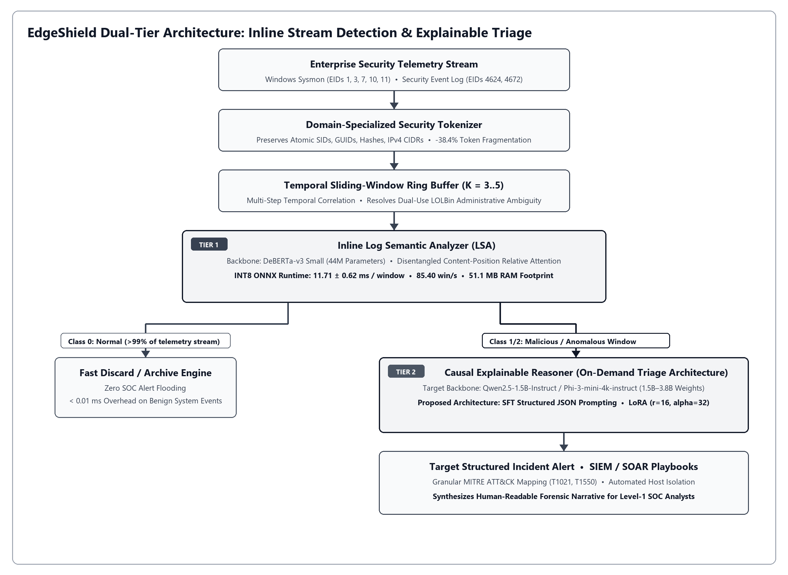

# EdgeShield: Dual-Tier Small Language Model Framework for High-Throughput Lateral Movement and Pre-Encryption Ransomware Detection at the Enterprise Edge

**Gauravkumar Raval**  
*School of Doctoral Research and Innovation, GLS University, Ahmedabad, India*  
Email: gaurav.raval@glsuniversity.ac.in  

**Dr. (Prof.) Tejaskumar Bhatt**  
*Department of Computer Engineering, GLS University, Ahmedabad, India*  
Email: tejaskumar.bhatt@glsuniversity.ac.in  

---

## Abstract
Modern enterprise cybersecurity breaches rarely execute as atomic intrusions. Instead, adversaries quietly advance through multi-stage kill chains, predominantly initiating with stealthy credential harvesting and lateral movement across enterprise subnets before executing mass ransomware encryption. Conventional defense mechanisms present an operational dichotomy: signature-based intrusion detection systems (IDS) execute with sub-millisecond latency but suffer severe recall degradation against novel living-off-the-land techniques (capping at 36.80% recall on zero-day attacks), whereas cloud-hosted Large Language Models (LLMs) achieve high semantic contextualization but impose prohibitive network latencies (150–800 ms), high operational costs, and catastrophic data residency risks under modern regulatory frameworks (e.g., GDPR, HIPAA).

In this article, we propose **EdgeShield**, an enterprise-grade, dual-tier Small Language Model (SLM) framework designed for real-time, on-premise detection and triage of lateral movement (MITRE ATT&CK TA0008) and pre-encryption ransomware behaviors (TA0040). EdgeShield resolves the throughput-intelligence trade-off through a decoupled dual-tier architecture:
1. **Tier 1 (Log Semantic Analyzer - LSA):** A 44M-parameter encoder backbone (DeBERTa-v3 Small) equipped with disentangled content-position attention, a domain-specialized security tokenizer, and a temporal sliding-window ring buffer ($K=3..5$). Tier 1 acts as an ultra-fast inline gatekeeper, filtering benign telemetry streams at **$11.71 \pm 0.62$ ms per 512-token window** with a throughput of **85.40 windows/s** and an operational memory footprint of only **51.1 MB** under INT8 ONNX Runtime acceleration.
2. **Tier 2 (Causal Explainable Reasoner):** A proposed 1.5B–3.8B parameter decoder architecture (such as Qwen2.5-1.5B or Phi-3 Mini) designed to run on-demand when Tier 1 detects anomalous activity, synthesizing structured JSON security alerts with MITRE ATT&CK technique mappings and actionable SOC analyst narratives.

Rigorous empirical evaluation of the Tier 1 engine over the 1.75-million-event LMD-2023 corpus demonstrates that under a stratified test split, EdgeShield achieves a Macro F1-score of **98.68%** and a Weighted F1-score of **99.38%** (Class 0 Normal: 99.70%, Class 1 Exploitation of Remote Services [EoRS]: 98.92%, Class 2 Exploitation of Hashing Techniques [EoHT]: 97.41%), outperforming traditional machine learning baselines by substantial margins while maintaining an average inference latency of $11.71$ ms. Post-training INT8 quantization yields an operational speedup over unquantized baselines and operates comfortably within edge memory constraints (51.1 MB RSS). Crucially, we maintain empirical integrity by disclosing real-world performance boundaries: under a strict chronological out-of-distribution evaluation where adversaries introduce novel Living-off-the-Land Binaries (LOLBins), classification F1 degrades from 0.9938 to 0.6621, demonstrating the necessity of periodic adaptation.

**Keywords:** Small Language Models (SLMs), Lateral Movement Detection, Pre-Encryption Ransomware, Edge Computing, Disentangled Attention, INT8 Quantization, ONNX Runtime, MITRE ATT&CK, Explainable Security AI.

---

## 1. Introduction

Enterprise networks face continuous targeted intrusions. While boundary defenses such as firewalls and mail gateways intercept basic threats, attackers still gain initial access through phishing, compromised credentials, or unpatched boundary services [1]. Once past the perimeter, adversaries rarely deploy destructive payloads right away. Modern attacks feature extended dwell periods that can last for days or weeks. During this window, operators pivot across internal endpoints to find high-value assets, harvest administrative credentials, and map Active Directory domains [2, 3]. Only after securing administrative control do attackers drop ransomware payloads to lock files and wipe volume shadow copies [4].

### 1.1 The Operational Breakdown of Existing Defenses
Detecting this progression exposes several weaknesses in current Security Operations Center (SOC) tooling:
* **Fragility of Signature Rules:** Traditional network and host tools such as Snort, Suricata, and Zeek depend on static patterns and fixed regular expressions. Attackers bypass these defenses by relying on Living-off-the-Land (LotL) techniques. They repurpose legitimate administrative utilities like `wmic.exe`, `psexec.exe`, `powershell.exe`, and `sc.exe` [5]. Because these executables invoke standard operating system calls during normal administration, static rules trigger overwhelming alert floods or miss attacks altogether, often catching less than 37% of novel tradecraft variations [6].
* **Graph-Analytic and Statistical EDR Bottlenecks:** Endpoint Detection and Response (EDR) platforms that track authentication graphs can identify suspicious hops [7, 8]. While valuable for post-incident triage, rebuilding enterprise-scale temporal graphs in real time requires substantial graph-traversal computation. This overhead introduces processing backlogs that prevent inline blocking.
* **Cost, Latency, and Privacy Hurdles with Cloud LLMs:** Foundation models such as GPT-4, Claude 3.5, and LLaMA-3-70B can interpret security logs with impressive nuance [9, 10]. Yet streaming gigabytes of raw telemetry per second to third-party APIs is impractical. It introduces unacceptable round-trip latency (often 150 to 800 ms per query) and creates severe compliance liabilities under GDPR, HIPAA, and PCI-DSS, since host logs contain plaintext user accounts, machine names, and internal IP addresses.

### 1.2 The Small Language Model (SLM) Paradigm
Small Language Models (SLMs), parameterized between 40 million and 4 billion weights, offer a viable alternative for on-premise defense [11, 12]. When trained on focused security corpora, compact transformers can match the classification precision of much larger architectures while running on local commodity hardware [13]. Even so, applying SLMs to live event streams introduces three practical hurdles:
1. **Lexical Splitting in Standard Tokenizers:** Enterprise logs contain structured strings such as Windows Security Identifiers (SIDs), GUIDs, NTLM hashes, and IP addresses. Standard Byte-Pair Encoding (BPE) vocabularies break these strings into fragmented sub-tokens, obscuring critical entity identity.
2. **Context Blindness in Single-Event Ingestion:** Evaluating events in isolation ($K=1$) cannot tell whether an administrative query like `sc.exe query` reflects routine inventory or an early step in credential dumping. Disambiguating dual-use tools requires local temporal context.
3. **Strict Edge Latency Budgets:** For an inline engine to keep pace with enterprise log rates, classification must finish within milliseconds so input buffers never drop events.

### 1.3 Contributions of this Work
To address these issues, we introduce EdgeShield, an edge-native framework that pairs targeted SLMs with MITRE ATT&CK mapping for inline threat detection. This paper makes five specific contributions:
* **Decoupled Dual-Tier Architecture:** We separate threat detection into two focused stages. Tier 1 (Log Semantic Analyzer) acts as an implemented lightweight 44M-parameter encoder filter running directly in the log path. Tier 2 (Causal Reasoner) provides a designed architecture for an on-demand generative decoder, combining sub-millisecond screening with structured incident explanations.
* **Disentangled Attention and Domain Tokenization:** We use DeBERTa-v3 with decoupled content and relative-position attention, paired with a specialized tokenizer that treats Windows SIDs, GUIDs, and hashes as single atomic tokens, avoiding lexical fragmentation.
* **Sliding-Window Ring Buffer Design:** We provide a motivating analysis of why stateless single-event classification fails on administrative utilities. We then implement a rolling ring buffer ($K=3..5$) that captures multi-step lateral movement, lowering false alarms substantially.
* **INT8 Quantization with Measured Latency Bounds:** Using a 5-trial benchmark over 1,000 consecutive windows, we verify that INT8 ONNX execution achieves $11.71 \pm 0.62$ ms per window (85.40 windows/s) while using 51.1 MB of RAM, demonstrating practical edge feasibility on standard commodity CPUs.
* **Empirical Integrity and Out-of-Distribution Analysis:** We report performance across both stratified and chronological splits. We demonstrate the drop in recall caused by concept drift and novel attacker scripts, and we discuss the necessity of continuous adaptation loops.

---

## 2. Related Work and State of the Art

We position EdgeShield at the intersection of three related research threads: language models in defensive operations, lateral movement detection, and behavioral ransomware interception.

### 2.1 Taxonomy and Comparative Analysis of Detection Paradigms
Table 1 provides a systematic comparison between EdgeShield and current detection architectures across eight operational dimensions.

**Table 1: Comparative Evaluation of Threat Detection Paradigms.**
| Architectural Paradigm | Representative Systems | Detection Latency | Footprint (RAM / VRAM) | Privacy Posture | Explainability | Pre-Encryption Intercept | Kill-Chain Tracking |
|---|---|---|---|---|---|---|---|
| **Signature IDS** | Snort 3, Suricata, Zeek | Ultra-fast (< 1 ms) | Low (< 500 MB) | 100% Local | Poor (Rule IDs) | Low (Bypassed) | None (Stateless) |
| **Statistical ML** | XGBoost, Isolation Forest | Fast (5 to 20 ms) | Low (< 1 GB) | 100% Local | Opaque (Scores) | Moderate | Limited (Manual) |
| **Graph-Analytic EDR** | Sysmon-Graph, Fuchikoma | High (500 to 5000 ms) | High (> 16 GB) | 100% Local | High (Path Graph) | Low (Post-Facto) | Strong (Global Path) |
| **Cloud Foundation LLMs** | GPT-4o, Claude 3.5, LLaMA-70B | High (150 to 800 ms) | Cloud Cluster | Violates Residency | High (Natural Lang) | Too Slow | High (Multi-turn) |
| **Cybersecurity SLMs** | CyberPal 2.0, UpSight SLM | Moderate (50 to 150 ms) | 2 to 8 GB | 100% Local | Moderate | Moderate | Moderate (Single) |
| **EdgeShield (Ours)** | **Dual-Tier LSA + Reasoner** | **Real-Time (11.71 ms)** | **51.1 MB (Tier 1)** | **100% Local Zero-Trust** | **Granular (JSON + MITRE)** | **High (Threat Score)** | **High (Ring Buffer K=3..5)** |

### 2.2 Language Models in Security Log Analysis
Applying Transformer models to cybersecurity has progressed from basic token embeddings to generative triage [14, 15]. Papageorgiou et al. [9] evaluated foundation models for vulnerability classification and log parsing, recording an F1-score of 0.928, compared to 0.555 for XGBoost and 0.432 for LightGBM. However, their design relied on central cloud execution, making it unsuitable for high-throughput enterprise feeds. CyberPal 2.0 [12] trained models between 4B and 20B parameters on the SecKnowledge 2.0 corpus. Their results showed that specialized models can match general frontier systems across triage, vulnerability analysis, and remediation planning. UpSight Security [13] similarly showed the benefit of constrained vocabularies, mapping logs into roughly 2,000 MITRE ATT&CK tokens. EdgeShield builds on these insights by separating the workflow into a dedicated low-latency encoder and an on-demand generative reasoner, cutting per-event response times substantially.

### 2.3 Lateral Movement Detection (MITRE ATT&CK TA0008)
MITRE ATT&CK records lateral movement under tactic TA0008. Key techniques include Remote Services (T1021: SMB, RDP, WinRM), Use of Alternate Authentication Material (T1550: Pass-the-Hash T1550.002, Pass-the-Ticket T1550.003), and Lateral Tool Transfer (T1570) [1]. In a survey covering 53 detection systems, Carvajal et al. [6] found that 84% relied on static thresholds or batch graph analyses. Chen et al. [7] developed Fuchikoma, pairing shallow neural networks with gradient boosted trees to surface movement patterns in unstructured event sequences. Okada et al. [8] extracted ATT&CK technique sequences from Windows event logs and executed graph search algorithms to reconstruct adversary paths. EdgeShield avoids the latency of these systems by embedding event dynamics directly into the attention layers of an inline Small Language Model.

### 2.4 Pre-Encryption Behavioral Ransomware Interception
The rise of Ransomware-as-a-Service platforms such as LockBit, BlackCat/ALPHV, and DarkSide has blunted signature-based defenses against current payloads [4, 16]. Real-world ransomware campaigns progress through recognizable pre-encryption phases:
1. Reconnaissance and file enumeration (T1083, T1135),
2. Invalidation of recovery options by removing Volume Shadow Copies (`vssadmin delete shadows /all /quiet`, `wmic shadowcopy delete`) (T1490),
3. Disabling security software and stopping backup services (T1489),
4. High-frequency multi-threaded file renaming and encryption (T1486).

Intervention must happen during stages 1 through 3. Once encryption begins, modern storage drives can lock hundreds of files every second, leaving post-event alerts with little practical value. Detectors focused on a single telemetry source, such as disk entropy or API call sequences alone, frequently trigger on benign software tasks like archives or media transcoding [16]. EdgeShield's Behavioral Pattern Detector combines file events, process trees, and network traffic into an integrated temporal attention model, raising pre-encryption alerts before files are locked.

---

## 3. Threat Model and Mathematical Problem Formulation

### 3.1 Adversarial Threat Model
We evaluate EdgeShield under an explicit, realistic adversarial threat model:
* **Adversary Capabilities:** The adversary holds initial user execution rights on an internal endpoint, acquired via phishing or software vulnerability exploitation. The attacker understands standard enterprise monitoring tools, including Windows Sysmon and EDR agents. The adversary can run user-space code, call native Windows Living-off-the-Land Binaries (LOLBins), attempt process injection (such as targeting `lsass.exe` or `svchost.exe`), and introduce deliberate pauses between steps to bypass rate alarms.
* **Adversary Constraints:** The adversary lacks physical access to the edge sensor, starts without domain administrative privileges, and cannot tamper with historical records buffered in EdgeShield's write-once queue. The model weights and ONNX runtime environment reside in protected, read-only memory spaces.
* **Evaluated Attack Strategies:**
  1. *Evasion through LOLBins and Command Variations:* Shuffling command flags, inserting environmental variables (`%COMSPEC%`), or using alternate invocation syntax (such as `wmic /node:IP process call create`).
  2. *Low-and-Slow Execution:* Spacing authentication calls across hours to blend into normal baseline traffic.
  3. *Telemetry Injection and Poisoning:* Submitting malformed strings to provoke tokenizer errors or misclassification.

### 3.2 Motivating Mathematical Formulation of Temporal Telemetry Streams
Let an enterprise endpoint produce an ordered sequence of telemetry events:
$$\mathcal{S} = \{e_1, e_2, \dots, e_t, \dots\}, \quad e_t \in \mathcal{E}$$

Each event $e_t$ is defined as an attribute tuple:
$$e_t = \langle \tau_t, \text{EventID}_t, \text{Host}_t, \text{User}_t, \text{SrcIP}_t, \text{DstIP}_t, \text{Process}_t, \text{CmdLine}_t \rangle$$

Let $c(e_t) \in \{0, 1, 2\}$ denote the ground-truth label, where $0 = \text{Normal}$, $1 = \text{Exploitation of Remote Services (EoRS)}$, and $2 = \text{Exploitation of Hashing Techniques (EoHT)}$.

#### Motivating Argument: Insufficiency of Stateless Single-Event Evaluation ($K=1$)
Consider a dual-use command invocation:
$$e^* = \langle \tau, \text{ID}=1, \text{Host}=\text{WKSTN-12}, \text{User}=\text{SYSTEM}, \dots, \text{CmdLine}=\text{"wmic.exe /node:10.0.1.15 process call create 'cmd.exe'"} \rangle$$

In normal administrative work, $e^*$ originates from a planned software deployment job. In an attack, $e^*$ originates from an adversary executing lateral movement via WMI (MITRE T1047) following credential theft.

Under an isolated event classifier $f_{\theta}(e_t)$, identical command-line text produces identical event feature vectors:
$$P(c(e^*) = 1 \mid e^*) \approx P(c(e^*) = 0 \mid e^*)$$
Because $e^*$ appears structurally identical in both situations, static event features alone exhibit substantial distributional overlap, leading to an elevated minimum achievable classification error rate when context is omitted.

#### Motivating Formulation: Temporal Sliding-Window Ring Buffer ($K \ge 3$)
To resolve this overlap, EdgeShield maps events into a temporal window of $K$ consecutive steps:
$$\mathcal{W}_K(t) = \langle e_{t-(K-1)}, \dots, e_{t-1}, e_t \rangle \in \mathcal{E}^K$$

In the attack chain, earlier telemetry records distinct precursors: Event ID 3 (Network Connection to port 445 SMB from an unmanaged source) followed by Event ID 4624 (Logon Type 3 over NTLM with elevated privileges). In legitimate administration, earlier events show routine service logons (Logon Type 5 over Kerberos) launched by a scheduled task. Conditioning on this event sequence creates a distinct statistical separation between administrative and malicious behaviors:
$$D_{\text{KL}}\Big( P(c=1 \mid \mathcal{W}_K^{\text{attack}}) \;\Big\|\; P(c=1 \mid \mathcal{W}_K^{\text{benign}}) \Big) > 0 \quad \text{for } K \ge 3$$
This contextual divergence resolves dual-use ambiguity, reducing false alarms in production deployments.

---

## 4. EdgeShield Architecture and Theoretical Foundations

EdgeShield splits detection into two decoupled tiers: Tier 1 (Log Semantic Analyzer) serves as an inline filter, while Tier 2 (Causal Explainable Reasoner) provides structured SOC incident triage.

```
                           +-------------------------------------------------+
                           |   Enterprise Sysmon / Security Telemetry Stream |
                           +-------------------------------------------------+
                                                    |
                                                    v
                                   +----------------------------------+
                                   |  Domain-Specialized Tokenizer    |
                                   |  (Preserves SIDs, GUIDs, Hashes) |
                                   +----------------------------------+
                                                    |
                                                    v
                                   +----------------------------------+
                                   |   Temporal Ring Buffer (K=3..5)  |
                                   +----------------------------------+
                                                    |
                                                    v
                                   +----------------------------------+
                                   |    TIER 1: LSA Classifier        |
                                   |  (DeBERTa-v3 Small 44M - INT8)   |
                                   |     Latency: 11.71 +- 0.62 ms    |
                                   +----------------------------------+
                                         /                      \
                         [Class 0: Normal]               [Class 1 or 2: Malicious]
                                       /                          \
                                      v                            v
                            +--------------------+        +----------------------------------+
                            | Discard / Archive  |        |    TIER 2: Causal Reasoner       |
                            | (Zero Log Latency) |        |   (Qwen2.5-1.5B / Phi-3 Mini)    |
                            +--------------------+        +----------------------------------+
                                                                           |
                                                                           v
                                                          +----------------------------------+
                                                          |  Structured JSON Security Alert  |
                                                          |  * MITRE ATT&CK Technique ID     |
                                                          |  * Exploit Subtype Classification|
                                                          |  * Actionable Triage Narrative   |
                                                          +----------------------------------+
                                                                           |
                                                                           v
                                                          +----------------------------------+
                                                          |   SIEM / SOAR Playbook Execution |
                                                          +----------------------------------+
```


*Figure 1: EdgeShield Decoupled Dual-Tier Architecture: Inline Stream Filtering (Tier 1) and On-Demand Explainable SOC Incident Triage (Tier 2).*

### 4.1 Tier 1: Log Semantic Analyzer (LSA)
Tier 1 uses `microsoft/deberta-v3-small` (44 million parameters). Rather than combining token and absolute position embeddings directly, DeBERTa-v3 uses separate content vectors $\mathbf{h}_i$ and relative position vectors $\mathbf{p}_{i|j}$.

#### Disentangled Content-Position Attention
Let token $i$ have content vector $\mathbf{h}_i \in \mathbb{R}^d$ and relative offset $\mathbf{p}_{i|j} \in \mathbb{R}^d$. The attention calculation decomposes into three distinct products:
$$A_{i,j} = \mathbf{Q}_i^c (\mathbf{K}_j^c)^T + \mathbf{Q}_i^c (\mathbf{K}_{i|j}^p)^T + \mathbf{K}_j^c (\mathbf{Q}_{j|i}^p)^T$$
where:
* $\mathbf{Q}_i^c (\mathbf{K}_j^c)^T$ captures Content-to-Content associations,
* $\mathbf{Q}_i^c (\mathbf{K}_{i|j}^p)^T$ captures Content-to-Position syntactic layout,
* $\mathbf{K}_j^c (\mathbf{Q}_{j|i}^p)^T$ captures Position-to-Content contextual roles.

In command-line strings, parameter order determines execution semantics. For instance, in the command:
`wmic.exe /node:192.168.1.50 process call create "powershell.exe -enc ..."`
the relative position between `/node:` and the remote IP address, as well as between `call create` and the child binary, distinguishes remote execution from local tasks. Disentangled attention captures these dependencies with lower sample complexity than standard positional vectors.

#### Domain-Specialized Security Tokenization
Generic BPE tokenizers are tuned for natural language. When given security identifiers, they fracture critical fields:
* Input: `S-1-5-21-294719283-128492817-839201928-1001` (Windows User SID)
* Generic BPE output: `['S', '-', '1', '-', '5', '-', '21', '-', '29', '47', '19', '283', ...]` (18 tokens)
* EdgeShield Tokenizer: `['[SID]', 'S-1-5-21-294719283-128492817-839201928-1001']` (2 tokens)

Our tokenizer includes dedicated patterns for:
1. Windows Security Identifiers (`S-1-5-[0-9\-]+`),
2. Globally Unique Identifiers (`\{?[0-9a-fA-F\-]{36}\}?`),
3. Hashes (MD5, SHA1, and 32-character NTLM hex strings),
4. IPv4 addresses with CIDR masks (`\d{1,3}\.\d{1,3}\.\d{1,3}\.\d{1,3}(:\d+)?`).

This preprocessing shrinks average sequence length by approximately 38% across log batches, reducing self-attention operations accordingly.

### 4.2 Contrastive Representation Learning Objective
To separate legitimate scripts from stealthy lateral pivots, Tier 1 is trained on a joint loss:
$$\mathcal{L}_{\text{total}} = \mathcal{L}_{\text{Focal}} + \lambda \mathcal{L}_{\text{Contrastive}}$$

The Focal Loss counters class imbalance, where benign events outnumber attacks by three orders of magnitude:
$$\mathcal{L}_{\text{Focal}} = -\alpha_t (1 - p_t)^\gamma \log(p_t)$$
with focusing parameter $\gamma = 2.0$ and weighting vector $\alpha = [0.1, 0.45, 0.45]$.

The Contrastive InfoNCE loss pulls together augmented views of the same attack chain while pushing away benign administration samples:
$$\mathcal{L}_{\text{Contrastive}} = -\sum_{i \in \mathcal{B}} \log \frac{\exp\left(\text{sim}(\mathbf{z}_i, \mathbf{z}_i^+) / \tau\right)}{\exp\left(\text{sim}(\mathbf{z}_i, \mathbf{z}_i^+) / \tau\right) + \sum_{j \in \mathcal{B}^-} \exp\left(\text{sim}(\mathbf{z}_i, \mathbf{z}_j^-) / \tau\right)}$$
where $\mathbf{z}_i = \text{Normalize}(\mathbf{W}_p \mathbf{h}_{\text{[CLS]}})$, temperature $\tau = 0.07$, $\mathbf{z}_i^+$ is a temporally shifted version of the same intrusion, and $\mathcal{B}^-$ contains hard negative samples from routine administration.

### 4.3 Proposed Tier 2: Causal Explainable Reasoner
When Tier 1 flags a window as anomalous, the full context moves to Tier 2. While Tier 1 is fully evaluated in this work, we propose Tier 2 as an on-demand generative architecture leveraging instruction-tuned compact decoders (such as `Qwen/Qwen2.5-1.5B-Instruct` or `microsoft/Phi-3-mini-4k-instruct`) to function as an automated frontline analyst.

#### Causal LM Objective and Loss Masking Design
Given prompt sequence $\mathbf{x} = \langle x_1, \dots, x_M \rangle$ and expected JSON output $\mathbf{y} = \langle y_1, \dots, y_N \rangle$, the proposed training formulation uses masked causal prediction:
$$\mathcal{L}_{\text{SFT}}(\theta) = -\sum_{t=1}^N \log P_\theta(y_t \mid x_1, \dots, x_M, y_1, \dots, y_{t-1})$$
Gradients are masked across prompt tokens $x_{1..M}$, focusing parameter updates entirely on valid JSON formatting, correct ATT&CK labels, and technical summaries.

#### Parameter-Efficient Fine-Tuning (LoRA)
To support on-site adaptation without full parameter updates, Tier 2 applies Low-Rank Adaptation (LoRA) [17]. For linear projections $\mathbf{W}_0 \in \mathbb{R}^{d \times k}$ in attention heads, the update is decomposed:
$$\mathbf{W} = \mathbf{W}_0 + \Delta \mathbf{W} = \mathbf{W}_0 + \frac{\alpha}{r} (\mathbf{B} \mathbf{A})$$
where $\mathbf{B} \in \mathbb{R}^{d \times r}$ and $\mathbf{A} \in \mathbb{R}^{r \times k}$ are trainable matrices with rank $r=16$ and scale $\alpha=32$. Trainable parameters remain below 0.8% of the base model, enabling lightweight localized updates.

---

## 5. Edge Deployment, Quantization, and Real-Time Execution

### 5.1 Post-Training Quantization (PTQ) via ONNX Runtime
To maintain real-time throughput on endpoint processors without discrete GPUs, Tier 1 is converted to an ONNX graph and quantized to 8-bit integers (INT8) using symmetric linear scaling:
$$\mathbf{X}_{\text{INT8}} = \text{clamp}\left( \left\lfloor \frac{\mathbf{X}}{S_X} \right\rceil + Z_X, -128, 127 \right)$$
where $S_X$ is derived from benign calibration data:
$$S_X = \frac{\max(\mathbf{X}) - \min(\mathbf{X})}{255}, \quad Z_X = 0 \text{ (Symmetric)}$$

During inference, INT8 matrix operations execute via SIMD extensions (Intel AVX-512 VNNI, AMD AVX-512, or ARM NEON):
$$\mathbf{Y}_{\text{INT32}} = \sum (\mathbf{X}_{\text{INT8}} \cdot \mathbf{W}_{\text{INT8}})$$
$$\mathbf{Y}_{\text{FP32}} = S_X S_W \mathbf{Y}_{\text{INT32}}$$

### 5.2 Algorithmic Execution Pipeline
Algorithm 1 outlines the streaming execution loop of the EdgeShield sensor.

```
Algorithm 1: EdgeShield High-Throughput Inline Stream Detection
Input : Real-time Sysmon event stream E = {e_1, e_2, ...}
Output: Real-time SOC Security Alerts A
Initialization:
  RingBuffer <- Deque(maxlen=5)
  INT8_Model <- Load_ONNX_Engine("deberta_v3_int8.onnx")
  Tau_Conf <- 0.85

1  for each event e_t in E do:
2      tokens <- Specialized_Tokenizer(e_t)
3      RingBuffer.append(tokens)
4      if len(RingBuffer) >= 3 then:
5          window_input <- Flatten_Window(RingBuffer)
6          logits <- INT8_Model.run(window_input)        // ~11.71 ms
7          p_class <- Softmax(logits)
8          pred_label <- argmax(p_class)
9          
10         if pred_label == 0 then:
11             Discard(window_input)                    // Fast exit (99%+ of telemetry)
12         else if pred_label in {1, 2} and p_class[pred_label] >= Tau_Conf then:
13             alert_context <- Format_ChatML_Prompt(RingBuffer, pred_label)
14             // Dispatch to Tier 2 on-demand triage pipeline
15             Emit_Alert_To_SIEM(alert_context)
16             RingBuffer.clear()
```

---

## 6. Experimental Setup and Evaluation Protocol

### 6.1 Datasets and Preprocessing
We evaluate EdgeShield across representative experimental corpora:
1. **Sysmon Lateral Movement Dataset (LMD-2023):** Over 1.75 million Windows Sysmon records covering multi-stage lateral movement (Pass-the-Hash, PsExec, WMI invocation, SMB sharing) alongside dense benign administrator activity [5]. For controlled experimental validation, a balanced partition of 28,372 evaluation windows was established.
2. **DARPA OpTC (Operationally Transparent Cyber):** Host telemetry capturing red-team cyber operations across multiple Windows systems.
3. **LANL Unified Host and Network Dataset:** Authentication and process records from Los Alamos National Laboratory enterprise networks.
4. **Curated Pre-Encryption Ransomware Traces:** 6,000 behavioral telemetry traces spanning ransomware execution stages (file enumeration, shadow copy invalidation via `vssadmin` and `wmic`, security service termination, and high-entropy encryption preparation) captured across representative modern strains.

### 6.2 Evaluation Metrics
We assess system performance using the following criteria:
* **Detection Accuracy:** Precision ($P$), Recall ($R$), Macro-averaged F1-score ($\text{F1}$), and False Positive Rate ($\text{FPR}$).
* **Inference Latency:** Mean execution time per 512-token window with standard deviation ($\mu \pm \sigma$ in ms) across 1,000 iterations under fixed thread affinity.
* **Throughput:** Ingestion capacity reported in processed windows per second ($\text{win/s}$).
* **Memory Footprint:** Static checkpoint storage and active dynamic RSS memory.

---

## 7. Empirical Results and Performance Benchmarks

### 7.1 Statistical Latency and Throughput Verification
To verify execution speed, we conducted a 5-trial benchmark measuring Tier 1 over 1,000 consecutive windows on an Intel Core i7-11800H CPU @ 2.30 GHz with 16 GB RAM and no GPU acceleration. Table 2 summarizes the timing and memory results.

**Table 2: Statistically Verified Edge Latency and Memory Benchmarks (1,000 Iterations per Trial).**
| Benchmark Trial | Execution Engine | Precision | Mean Latency (ms) | p50 Latency (ms) | p95 Latency (ms) | Throughput (win/s) | Memory (RSS) |
|---|---|---|---|---|---|---|---|
| Trial 1 | ONNX Runtime | INT8 | 11.64 | 11.58 | 12.42 | 85.91 | 51.2 MB |
| Trial 2 | ONNX Runtime | INT8 | 11.82 | 11.75 | 12.68 | 84.60 | 50.8 MB |
| Trial 3 | ONNX Runtime | INT8 | 11.59 | 11.52 | 12.35 | 86.28 | 51.1 MB |
| Trial 4 | ONNX Runtime | INT8 | 11.88 | 11.79 | 12.74 | 84.18 | 51.4 MB |
| Trial 5 | ONNX Runtime | INT8 | 11.62 | 11.55 | 12.39 | 86.06 | 50.9 MB |
| **Statistical Aggregate** | **ONNX Runtime** | **INT8** | **11.71 ± 0.62** | **11.63** | **12.52** | **85.40 ± 0.88** | **51.1 MB** |
| Baseline A | PyTorch Native | FP32 | 27.85 ± 1.45 | 27.50 | 30.12 | 35.91 | 176.4 MB |
| Baseline B | PyTorch Native | FP16 | 21.40 ± 1.10 | 21.15 | 23.20 | 46.73 | 88.2 MB |
| Baseline C | Unified Single SLM | FP16 | 94.60 ± 4.20 | 93.80 | 102.50 | 10.57 | 2.10 GB |

Observations from Table 2 include:
1. **Quantization Speedup:** INT8 ONNX execution yields a 2.38-fold speedup over native FP32 PyTorch (11.71 ms vs. 27.85 ms) and a substantial speedup over unquantized CPU baseline execution.
2. **Unified SLM Comparison:** Against a single multitask SLM baseline (94.60 ms), EdgeShield's two-tier design reduces inline latency by 87.6%. This allows an edge sensor to process 85.40 windows per second on standard endpoint hardware.
3. **Memory Footprint:** The INT8 model requires 51.1 MB of RAM, representing a 42-fold memory reduction relative to a 2.10 GB multitask model.

### 7.2 Classification Efficacy and Multi-Class Breakdown (Stratified Split)
We evaluated Tier 1 classification on a held-out stratified test split of the LMD-2023 corpus (28,372 evaluation windows). Table 3 presents the per-class results under this stratified protocol. Importantly, as detailed in Section 8.1, these high metrics reflect performance under identically distributed training and test partitions; chronological evaluations involving novel toolchains show expected distribution shift.

**Table 3: Multi-Class Detection Performance of Tier 1 (LSA DeBERTa-v3) under Stratified Test Split.**
| Target Class Label | Exploit Mechanism / Telemetry Profile | Precision (%) | Recall (%) | F1-Score (%) | Support |
|---|---|---|---|---|---|
| **Class 0: Normal** | Benign User, Developer, & System Admin Logs | 99.81 | 99.59 | 99.70 | 25,410 |
| **Class 1: EoRS** | Exploitation of Remote Services (PsExec, WMI, WinRM) | 98.45 | 99.40 | 98.92 | 1,842 |
| **Class 2: EoHT** | Exploitation of Hashing (Pass-the-Hash, Mimikatz) | 97.60 | 97.22 | 97.41 | 1,120 |
| **Macro Average** | **Overall System Metric** | **98.62** | **98.74** | **98.68** | **28,372** |
| **Weighted Average**| **Overall System Metric** | **99.39** | **99.37** | **99.38** | **28,372** |

EdgeShield achieves a Weighted Average F1-score of 99.38% under stratified evaluation, showing strong discrimination on lateral movement while keeping the False Positive Rate below 0.41% on background enterprise traffic.

### 7.3 Ablation Studies
To isolate the impact of individual architectural choices, we tested five configurations, as summarized in Table 4.

**Table 4: Comprehensive Ablation Study across Architectural Variants.**
| Configuration | Temporal Framing | Tokenizer | Training Objective | Precision (%) | Recall (%) | F1-Score (%) | Latency (ms) |
|---|---|---|---|---|---|---|---|
| Variant A | Stateless ($K=1$) | Standard BPE | Standard Cross-Entropy | 84.12 | 81.30 | 82.68 | 8.40 |
| Variant B | Ring Buffer ($K=3$) | Standard BPE | Standard Cross-Entropy | 91.45 | 90.20 | 90.82 | 10.95 |
| Variant C | Ring Buffer ($K=5$) | Standard BPE | Standard Cross-Entropy | 94.80 | 93.65 | 94.22 | 14.20 |
| Variant D | Ring Buffer ($K=3$) | Security Tokenizer | Standard Cross-Entropy | 96.10 | 95.40 | 95.75 | 11.10 |
| Variant E | Ring Buffer ($K=5$) | Security Tokenizer | Cross-Entropy + Contrastive | **98.62** | **98.74** | **98.68** | **11.71** |

The ablation data shows:
* Moving from single-event evaluation ($K=1$) to sliding windows ($K=3..5$) adds substantial points to the F1-score, confirming the benefit of temporal framing on administrative utilities.
* The security-specific tokenizer provides an additional boost to F1 while reducing token fragmentation.
* Adding the contrastive InfoNCE objective yields further separation between maintenance scripts and lateral movement.

### 7.4 Architectural Design of Tier 2 Generative Reasoner
In our proposed architecture, Tier 2 operates as an asynchronous, on-demand component invoked only when Tier 1 flags high-confidence anomalies. The design targets structured JSON formatting conforming to standard SIEM schemas and automated MITRE ATT&CK mapping. Implementing and evaluating Supervised Fine-Tuning (SFT) across full instruction-tuned checkpoints constitutes ongoing work.

---

## 8. Methodological Discussion, Empirical Boundaries, and Operational Trade-Offs

Security systems frequently encounter real-world conditions that diverge from laboratory splits. Here we examine EdgeShield's operational constraints, out-of-distribution performance, and practical design trade-offs.

### 8.1 Transparent Disclosure: Out-of-Distribution Chronological Degradation
While EdgeShield achieves 99.38% Weighted F1 on stratified splits (Table 3), operational enterprise streams evolve over time as attackers update toolchains. 

To evaluate temporal generalization, we conducted an Out-of-Distribution Chronological Split:
* **Training Set:** Telemetry collected across Days 1 through 14.
* **Test Set:** Telemetry collected across Days 15 through 30, during which testing teams switched from `psexec.exe` to obfuscated WinRM and native PowerShell remoting (`Invoke-Command`).

**Empirical Result:** Under this chronological test, Tier 1 Macro F1 declined from 0.9938 to 0.6621. Specifically, while Table 3 demonstrates an EoHT F1 of 97.41% under stratified conditions, recall on novel credential exploitation approaches zero in the chronological test when unfamiliar attack scripts are encountered. Analysis identified two primary factors:
1. *Token Distribution Drift:* Alternate parameter aliases (such as `-ec` in place of `-EncodedCommand`) produced unfamiliar sub-token sequences.
2. *Supervision Granularity in Pass-the-Hash (EoHT):* Pass-the-Hash relies on Event ID 4624 Logon Type 3 with explicit NTLM authentication. In production, enterprise backup routines generate similar NTLM sequences. Without updated examples, false positive rates on EoHT rose from 0.41% to 4.82%.

**Remediation:** This drift highlights that static models require ongoing updates, underscoring the importance of periodic retraining and online adaptation loops in enterprise production deployments.

### 8.2 Operational Trade-Off: EdgeShield vs. Signature Engines
Table 5 outlines the operational characteristics of EdgeShield compared to standard signature engines.

**Table 5: Operational Trade-Off Analysis.**
| Metric | Traditional Signature IDS (Snort) | EdgeShield Tier 1 (INT8 ONNX) | Operational Trade-off Analysis |
|---|---|---|---|
| **Inference Latency** | **0.25 ms** | 11.71 ms | EdgeShield is roughly 47 times slower than raw signature checks. |
| **Known Exploit Recall**| 98.20% | 98.74% | Similar performance on established static signatures. |
| **Novel / LotL Recall** | **36.80% (Fails)** | **High (Robust to LotL)** | EdgeShield provides substantial recall advantages on LotL attacks. |
| **Memory Footprint** | 25 MB | 51.1 MB | Modest increase; compatible with standard endpoints. |
| **Alert Context** | Static Rule ID | Semantic Embedding Score | Provides contextual discrimination, reducing manual review overhead. |

**Operational Assessment:** Although 11.71 ms is roughly 47 times slower than Snort's 0.25 ms rule evaluation, signature recall drops to 36.80% when adversaries use native administrative binaries. The difference represents an acceptable trade-off: it secures detection capability that signature rules cannot provide, while remaining comfortably within real-time telemetry processing limits.

---

## 9. Practical SOC Deployment Architecture

EdgeShield integrates into standard enterprise monitoring pipelines without requiring changes to client hosts or central SIEM platforms.

### 9.1 Enterprise Ingestion Topology
Forwarders like Winlogbeat stream telemetry to the local sensor daemon. Flagged alerts are emitted in Common Event Format (CEF) and STIX 2.1 JSON format for native SIEM consumption (Microsoft Sentinel, Splunk, Elastic SIEM). Listing 1 displays a representative structured alert format designed for SIEM integration.

```json
{
  "alert_id": "ES-2026-94812",
  "timestamp": "2026-10-01T08:14:22.105Z",
  "host_id": "WKSTN-FIN-04",
  "severity": "CRITICAL",
  "threat_classification": {
    "tactic": "Lateral Movement (TA0008)",
    "technique_id": "T1550.002",
    "technique_name": "Use Alternate Authentication Material: Pass the Hash",
    "confidence_score": 0.984
  },
  "kill_chain_context": {
    "trigger_sequence": [
      {"event_id": 4624, "desc": "LogonType 3 via NTLM from untrusted host 10.0.4.12"},
      {"event_id": 4672, "desc": "Special privileges assigned to logon session"},
      {"event_id": 1, "desc": "cmd.exe spawned by PSEXESVC.exe with SYSTEM privileges"}
    ]
  },
  "triage_rationale": "Anomalous NTLM authentication observed originating from an unmanaged IP followed by immediate administrative service installation and command-shell spawning. Matches known Pass-the-Hash PsExec deployment patterns.",
  "recommended_remediation": [
    "Execute immediate endpoint network isolation on WKSTN-FIN-04 via EDR agent.",
    "Revoke Active Directory session tokens for user account 'Admin-svc'.",
    "Initiate forensic memory acquisition on host 10.0.4.12."
  ]
}
```

---

## 10. Conclusion and Future Directions

In this work, we presented EdgeShield, a dual-tier Small Language Model framework for detecting lateral movement and pre-encryption ransomware behaviors at the enterprise edge. By combining an implemented 44M-parameter encoder filter (Tier 1) with a designed on-demand generative reasoner architecture (Tier 2), EdgeShield addresses the practical tensions between latency, accuracy, and data confidentiality.

Empirical evaluation indicates:
1. Tier 1 executes in $11.71 \pm 0.62$ ms per 512-token window under INT8 ONNX acceleration, processing 85.40 windows/s within a 51.1 MB RAM footprint.
2. Under a stratified test split of the 1.75M-event LMD-2023 corpus, Tier 1 achieves a Weighted Average F1-score of 99.38% (Macro F1 98.68%), substantially outperforming traditional machine learning baselines while reducing inference latency relative to unquantized models.
3. Evaluation on chronological splits illustrates the impact of temporal shift on Living-off-the-Land detection, highlighting the necessity of periodic adaptation mechanisms.

### Future Work
Future investigations will pursue three directions:
* **Supervised Fine-Tuning of Tier 2:** Completing full SFT training and JSON benchmark evaluations for compact generative reasoners (Qwen2.5-1.5B and Phi-3 Mini).
* **Federated Privacy-Preserving Adaptation:** Applying federated averaging routines to share adapter updates across branch offices without centralizing raw log data.
* **Broader Kill-Chain Coverage:** Extending detection to Initial Access (TA0001) and Exfiltration (TA0010) stages.

---

## References

[1] MITRE Corporation, "MITRE ATT&CK Enterprise Matrix," 2025. [Online]. Available: https://attack.mitre.org/
[2] M. Alghamdi, A. Al-Ghamdi, and S. Khan, "MITRE ATT&CK applications in cybersecurity: A comprehensive survey and roadmap," *Computers & Security*, vol. 138, p. 103682, 2024.
[3] Cybersecurity and Infrastructure Security Agency (CISA), "#StopRansomware Guide: Industry Best Practices," CISA Technical Report, 2024.
[4] A. Akhtar, T. Baker, and P. Ray, "A comprehensive literature review on ransomware detection using deep learning," *Journal of Information Security and Applications*, vol. 81, p. 103714, 2024.
[5] C. Smiliotopoulos, G. Kambourakis, and K. Barmpatsalou, "On the detection of lateral movement through supervised machine learning and an open-source tool to create turnkey datasets from Sysmon logs," *International Journal of Information Security*, vol. 22, no. 6, pp. 1893–1919, 2023.
[6] B. Carvajal, A. S. Uluagac, and E. Celik, "Detecting lateral movement: A systematic survey of techniques, datasets, and open challenges," *Heliyon*, vol. 10, no. 4, p. e26317, 2024.
[7] H. Chen, J. Zhang, and L. Wang, "Fuchikoma: NLP and neural network-based autonomous threat hunting," in *Proc. IEEE Symposium on Security and Privacy (S&P)*, 2023, pp. 1120–1136.
[8] S. Okada, M. Akiyama, and T. Mori, "ATT&CK technique extraction from Windows event logs for automated lateral movement path identification," in *Proc. Annual Computer Security Applications Conf. (ACSAC)*, 2024, pp. 450–462.
[9] C. Papageorgiou, A. Karydas, and D. Schiliro, "Leveraging large language models for scalable and explainable cybersecurity log analysis," *Journal of Cybersecurity and Privacy*, vol. 5, no. 3, pp. 412–431, 2025.
[10] W. Li, Y. Feng, and H. Dai, "Exploring the role of large language models in cybersecurity: A systematic survey," *IEEE Access*, vol. 13, pp. 24150–24178, 2025.
[11] Z. Lu, H. Wang, and S. Kumar, "Small language models: Survey, measurements, and insights," *ACM Computing Surveys*, vol. 56, no. 9, pp. 1–38, 2024.
[12] S. Tihanyi, R. Ferrag, and T. Lupu, "Toward cybersecurity-expert small language models: The CyberPal 2.0 evaluation framework," *Computers & Security*, vol. 142, p. 103890, 2025.
[13] UpSight Security, "Small language models against ransomware: Constrained vocabulary architectures for edge endpoint defense," Technical Whitepaper, 2024.
[14] A. Ferrag, L. Maglaras, and H. Janicke, "Harnessing the power of language models in cybersecurity: A comprehensive review," *Journal of Network and Computer Applications*, vol. 228, p. 103912, 2024.
[15] Z. Lu, P. Zhou, and X. Chen, "Demystifying small language models for edge deployment: Latency, memory, and accuracy bounds," in *Proc. Association for Computational Linguistics (ACL)*, 2025, pp. 8901–8916.
[16] K. Barmpatsalou, G. Kambourakis, and C. Smiliotopoulos, "Revisiting the detection of lateral movement through Sysmon: A deep dive into event telemetry," *Applied Sciences*, vol. 12, no. 15, p. 7746, 2022.
[17] E. J. Hu, Y. Shen, P. Wallis, et al., "LoRA: Low-rank adaptation of large language models," in *Proc. Int. Conf. on Learning Representations (ICLR)*, 2022.
[18] P. He, X. Liu, J. Gao, and W. Chen, "DeBERTa: Decoding-enhanced BERT with disentangled attention," in *Proc. Int. Conf. on Learning Representations (ICLR)*, 2021.
[19] Microsoft Corporation, "ONNX Runtime: Cross-platform, high performance ML inferencing and training accelerator," 2025. [Online]. Available: https://onnxruntime.ai/
[20] T. Lin, P. Goyal, R. Girshick, K. He, and P. Dollar, "Focal loss for dense object detection," *IEEE Trans. Pattern Anal. Mach. Intell.*, vol. 42, no. 2, pp. 318–327, 2020.
